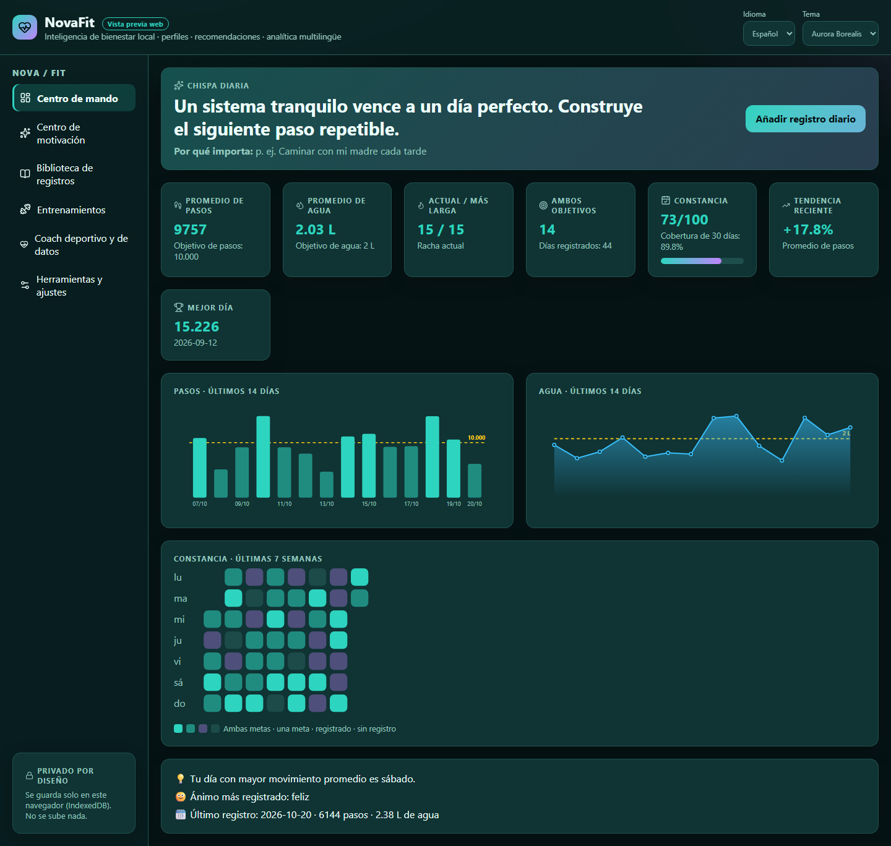
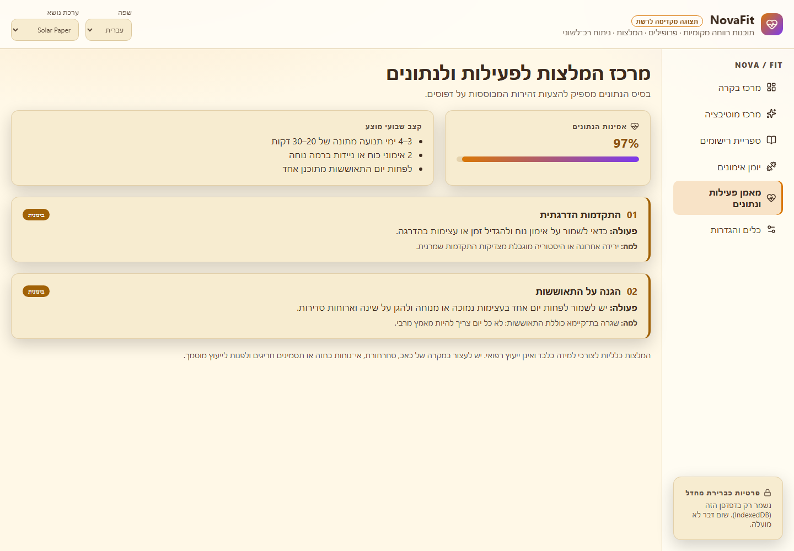
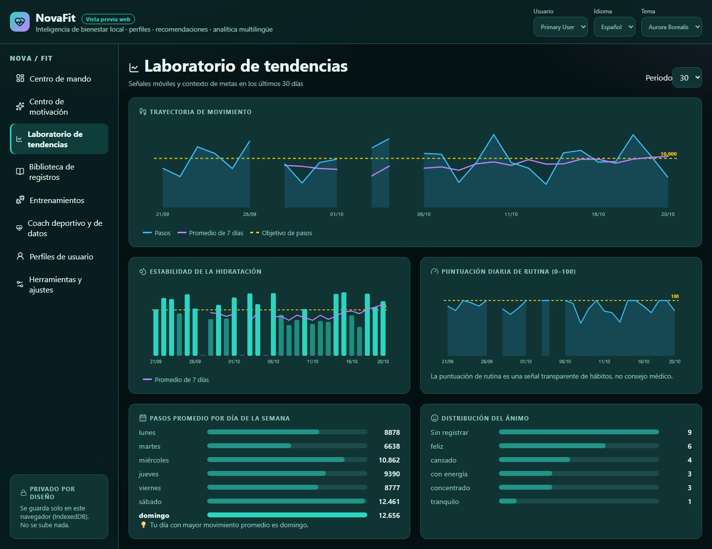
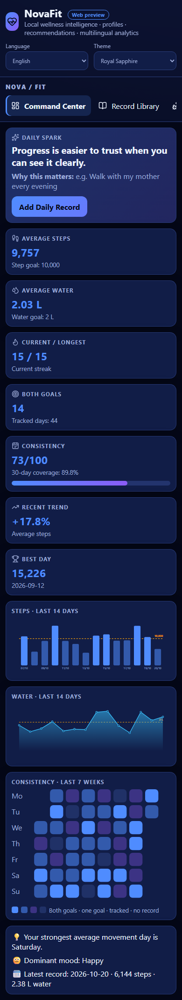
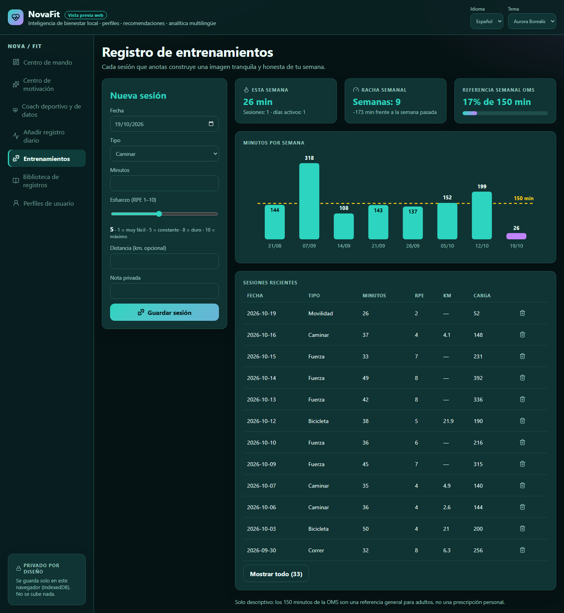
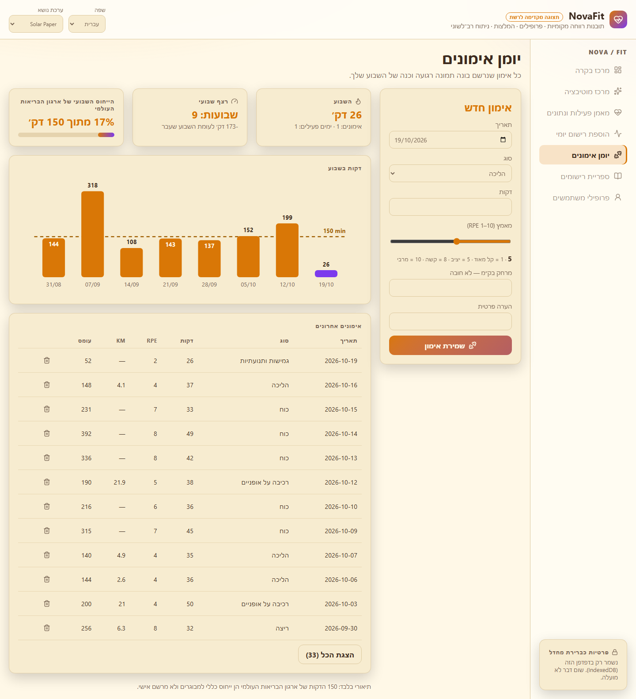

# NovaFit web 0.2.0

The NovaFit wellness studio in the browser: local-first (IndexedDB), English / Spanish / Hebrew with true RTL, and the
same twelve themes as the desktop app. Version 0.2.0 covers the daily workflow end to end:

| Page | What it does |
| --- | --- |
| Command Center | Daily spark + your personal why, 7 metric cards (averages, streaks, both-goal days, routine score, trend, best day), 14-day steps and water charts with goal lines, a 7-week consistency map, insights |
| Trend Lab | The desktop Trend Lab in the browser: 30 / 60 / 90-day steps with the 7-day rolling average and goal, hydration bars, daily routine score, average steps by weekday and mood distribution (ported from `analytics.py`) |
| Records | Add / edit / delete daily steps, water, calories, mood (chips) and notes; search; one record per date like the desktop |
| Training | Sessions, weekly cards, WHO reference bars, recent table |
| Motivation | Grounded headline, daily spark (same rotation as the desktop), next action, weekly challenge, milestone and the achievement constellation |
| Coach | The desktop's Sport & Data Coach (same rules and copy, including training-load cards) with data confidence and weekly rhythm |
| Profiles | Several local profiles, each in its own IndexedDB database (isolated records and sessions; deleting a profile removes only its data) |
| Tools | Goals, activity level, sport focus, personal why, JSON and CSV import/export compatible with the desktop (`novafit-health-export-v2`, `Date,Steps,Water (L),…`) and an offline HTML report (inline CSS + SVG, no scripts, every user string escaped, RTL in Hebrew) |

```bash
cd web
npm install
npm run dev            # http://localhost:5173  (add ?demo=1 to an empty browser profile for a demo week)
npm test               # Vitest: domain parity with the Python tests + app journeys
npm run build          # TypeScript + Vite production build in dist/
python scripts/export_from_python.py   # regenerate src/generated/*.json from the Python package (--check in CI)
```

## Why web, and how it reuses the desktop app

| Desktop (Python) | Web | How it is reused |
| --- | --- | --- |
| `novafit/i18n.py` — 381 keys × EN/ES/HE | `src/i18n.ts` | Exported as `src/generated/i18n.json`; one catalogue, no drift |
| `novafit/themes.py` — 12 themes | `src/theme.ts` + `styles.css` | Exported as CSS custom properties `--nf-*` |
| `novafit/workouts.py` | `src/domain/workouts.ts` | Ported 1:1; `workouts.test.ts` mirrors `tests/test_workouts.py` |
| SQLite (`novafit.db`) | IndexedDB via Dexie | Same fields; JSON and CSV export/import are the bridge |
| Tkinter panels | React components | Rewritten; layout uses CSS logical properties so Hebrew mirrors by itself |

Stack aligned with Nova Music Lab: React 19, TypeScript 6, Vite 8, Dexie 4, Vitest 5, lucide-react. No backend, no
account, no analytics: data never leaves the browser.

## Status and next steps

- [x] JSON bridge with the desktop (records + training sessions, row-level validation, duplicate-safe sessions)
- [x] Daily records, dashboard analytics (ported from `analytics.py` with Python-style rounding) and SVG charts
- [x] Coach (ported from `recommendations.py`; copy exported from Python)
- [x] Motivation Center: headline, micro-action, weekly challenge, milestone and 6 badges (ported from `motivation.py`)
- [x] Multiple local profiles (isolated databases) with their own goals, language, theme, activity level, sport focus and personal why
- [x] Installable PWA (manifest + offline shell; verified offline with Playwright)
- [x] Offline HTML report, the web counterpart of `novafit/reporting.py`
- [x] Trend Lab page (rolling averages, routine score, weekday rhythm, mood distribution)
- [x] Fixes from an independent Codex review (2026-10-20): drafts reset when the profile changes, local calendar day,
      service worker clears only its own caches, skip link keeps the current page
- [ ] GitHub Pages under `/NovaFit/app/`, Playwright journeys and axe checks in CI

The desktop app stays the complete reference until the web reaches parity.

## Screenshots (real browser captures, demo data)

 



  

## Profile and import safety

Profile data is displayed and exported only after the active profile has loaded. A delayed read from a previous
profile cannot replace the active snapshot. During loading, record and export controls are unavailable.

JSON and CSV imports are additive: an existing date is retained rather than overwritten, repeated input dates
keep the first row, and identical training sessions are skipped. The result reports how many rows were retained.
Entries and sessions are committed in one transaction; a failed insertion rolls back the entire import. To change
an existing day, use the Records editor deliberately instead of importing over it. Export a backup before editing.

Regression verification (2026-11-14): 37 Vitest tests passed; TypeScript/Vite build and generated-catalogue check
passed. The delayed-profile regression fails against the original PR head and passes with the fix. These are
local checks with synthetic data, not a deployed-browser or live-user-data test.
